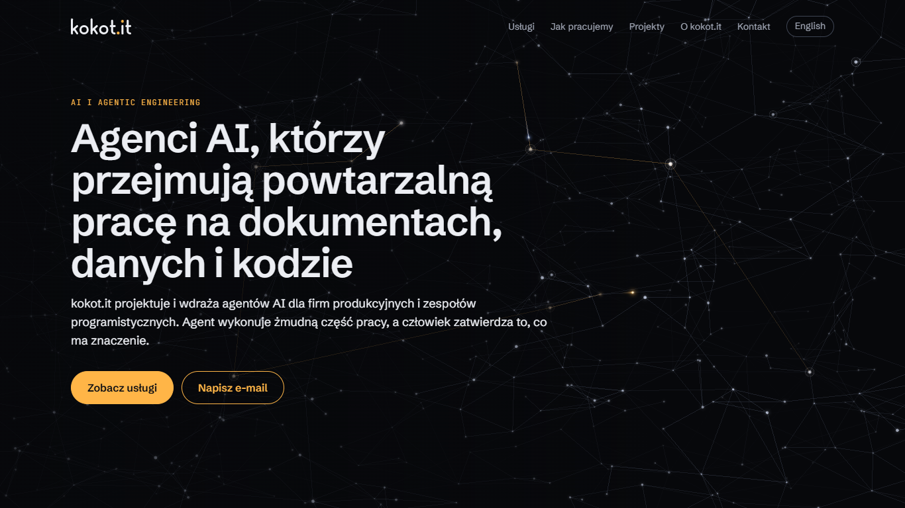

# kokot.it

The website of kokot.it — AI agents for manufacturing companies and software teams. A static,
bilingual (Polish and English) site with a live 3D backdrop, case studies that embed working
reference applications, and the print templates for the offer and the CV.



- **Static and readable without JavaScript.** Every page is rendered to HTML at build time;
  scripts only add the 3D scene and the embedded applications.
- **"Relay" 3D scene.** Vanilla Three.js with custom GLSL shaders, loaded lazily, with adaptive
  quality, reduced-motion and no-WebGL fallbacks.
- **Reference applications.** Three case studies embed a working application built from its own
  public repository at a pinned commit.
- **Guarded content.** The build fails on a phone number, a tax id, a price, a stray e-mail
  address or wording that must not ship; the test suite keeps the repository in English.

## Stack

Vite 8 (multi-page build), TypeScript (strict), Three.js, Vitest, Playwright (PDF rendering and
checks), ESLint + Prettier. No UI framework. Node 24 (`.nvmrc`).

## Quick start

```bash
npm ci
npm run dev        # http://localhost:5173/ (PL), http://localhost:5173/en/ (EN)
```

## Scripts

| Script                 | What it does                                                                                  |
| ---------------------- | --------------------------------------------------------------------------------------------- |
| `npm run dev`          | Vite dev server                                                                               |
| `npm run build`        | production build to `dist/`, then the content guard (`scripts/check-dist.ts`)                 |
| `npm run preview`      | serves the built `dist/`                                                                      |
| `npm run typecheck`    | `tsc --noEmit`                                                                                |
| `npm run lint`         | ESLint + `prettier --check`                                                                   |
| `npm run format`       | Prettier `--write` + `eslint --fix`                                                           |
| `npm test`             | Vitest, once; `npm run test:watch` to watch                                                   |
| `npm run tools:sync`   | rebuilds the reference applications in `public/tools/` from `tools.lock.json`                 |
| `npm run og:image`     | renders the social preview images (`public/og/kokot-it-<pl\|en>.png`, 1200 × 630)             |
| `npm run pdf`          | offer PL/EN, price quote PL (template + example), CV PL/EN → `out/pdf/`, then checks the PDFs |
| `npm run pdf:preview`  | renders the pages of the PDFs in `out/pdf/` to PNG in `out/preview/` for a visual check       |
| `npm run pdf:install`  | downloads Chromium for Playwright once (needed by `pdf` and `brand:assets`)                   |
| `npm run brand:assets` | generates the logo, sign and favicons (`public/brand/`, `public/favicon*`) from `tokens.css`  |

`out/`, `dist/` and `tmp/` are git-ignored. CI installs Chromium only for the PDF tests, which
run on a fictional CV.

## Project structure

```
index.html                     Polish home page (/)
en/index.html                  English home page (/en/)
projekty/<slug>/index.html     Polish case study (/projekty/<slug>/)
en/projects/<slug>/index.html  English case study (/en/projects/<slug>/)
src/main.ts                    shared entry point of every page
src/content/                   site copy (pl.ts, en.ts), the renderer to static HTML, content guards
src/build/                     Vite plugin that pours the copy into the page shells; page discovery
src/embed.ts                   lazy, sandboxed embedding of the reference applications
src/i18n/                      UI strings and per-locale paths
src/scene/                     Relay scene: pure logic (graph, layouts, routing, quality) + renderer
src/styles/                    brand tokens (tokens.css), base styles, content layout
src/assets/fonts/              brand fonts (woff2, OFL) and their licences
public/tools/<slug>/           built reference applications (generated, see below)
brand/index.html               brand system preview (dev server only: /brand/); rules in brand.md
docs/                          scene concept, design decisions, screenshots
docs-templates/                document templates (TypeScript → HTML): offer/, price-quote/, cv/
scripts/                       build guards, tool sync, PDF rendering and checks, brand assets
tests/                         repository guards (private data, CV content, language, wording)
```

Pages are thin `index.html` shells with `<!-- kokot:head -->` and `<!-- kokot:body -->` markers;
`src/content/render.ts` renders the copy into them in dev and in the build. A new case study is a
slug in `PROJECT_SLUGS` and `REPOS` (`src/content/types.ts`), its copy in `pl.ts` and `en.ts`
(the types require both), and the two shells `projekty/<slug>/index.html` and
`en/projects/<slug>/index.html` (a test checks that every route has its shell).

## Reference applications

The case studies of [factory-twin](https://github.com/Aberratio/factory-twin),
[production-docs-agent](https://github.com/Aberratio/production-docs-agent) and
[grant-assistant](https://github.com/Aberratio/grant-assistant) embed the application itself.
Each one is a static build from its public repository at the commit pinned in
`tools.lock.json`, committed under `public/tools/<slug>/`, so the site's build and deploy never
fetch or build anything else.

- **Embedding** (`src/embed.ts`): the static page carries a text fallback and a link that opens
  the application in a new tab. When the figure nears the viewport, an iframe loads
  `/tools/<slug>/?embed=1&lang=<pl|en>` with
  `sandbox="allow-scripts allow-same-origin allow-downloads allow-popups"` and
  `loading="lazy"`. Applications that post `{ type: '<slug>:height', height }` get an iframe
  sized to their content; messages count only from the site's own origin and from an embedded
  frame. Factory Twin reports no height and keeps a fixed proportion.
- **Updating**: put the new commit SHA in `tools.lock.json`, run `npm run tools:sync` (or
  `npm run tools:sync -- <slug>`) and commit the lock file with the rebuilt directory. See
  `public/tools/README.md`.
- The applications replay recorded runs on sample data and make no API calls.

## Search, social, privacy and accessibility

- **Head of every page** (`src/content/render.ts`): its own title and description per locale, a
  canonical URL, `hreflang` alternates (PL, EN, `x-default`), Open Graph and a
  `summary_large_image` Twitter card with the locale's image from `public/og/`. The home pages
  also carry JSON-LD: a `ProfessionalService` reachable by e-mail (no address, tax id or phone)
  and a `WebSite`.
- **`sitemap.xml` and `robots.txt`** are generated by the build from the route list
  (`src/build/seo.ts`). The brand preview is not built for production; the standalone pages of
  the reference applications send `X-Robots-Tag: noindex`.
- **No analytics, no cookies, no consent banner** (`docs/decisions/site-release.md`).
- **Headers** (`vercel.json`): a Content-Security-Policy with scripts and styles from the site
  only and framing limited to the site itself, `X-Content-Type-Options`, `X-Frame-Options`,
  `Referrer-Policy`, `Permissions-Policy`, `Cross-Origin-Opener-Policy`, HSTS, and a year of
  immutable caching for hashed assets. `npm run preview` sends the same headers.
- **Accessibility** (WCAG 2.2 AA): brand tokens meet AA contrast (`brand.md`), a skip link,
  keyboard-reachable navigation with a visible focus ring, `lang` on every page and on the
  language switch, a `title` on every embedded application, `prefers-reduced-motion` respected
  by the scene and the transitions, and a scrim that every browser can draw.

## Content guards

- **Build** (`scripts/check-dist.ts`, after `vite build`): every route is rendered; the site's
  pages contain no phone number, tax or registry id, price, e-mail address other than the
  contact one, placeholder, prototype wording, internal process reference or local path; every
  reference application is present. The applications' own pages are checked by their
  repositories.
- **Repository** (`tests/repo-guards.test.ts`): code, comments and docs are in English (Polish
  only in the Polish copy, the Polish document templates and sample data, and as quoted
  strings), and carry no prototype wording, planning ids or absolute local paths.
- **Private data** (`tests/no-private-data.test.ts`, `tests/cv-content-guard.test.ts`): no
  company data or phone number in the repository, and no distinctive text of the real CV.

## Documents: offer, price quote, CV

`npm run pdf` generates in one command (`out/pdf/`):

| File                             | What it is                                                               |
| -------------------------------- | ------------------------------------------------------------------------ |
| `oferta-pl.pdf`, `oferta-en.pdf` | general presentation offer, 2 A4 pages                                   |
| `oferta-cenowa-szablon-pl.pdf`   | price-quote template for a Dig.IT application, with `{{...}}` fields     |
| `oferta-cenowa-przyklad-pl.pdf`  | the same template filled with a fictional company (marked as `PRZYKŁAD`) |
| `cv-pl.pdf`, `cv-en.pdf`         | CV, 1–2 pages; skipped with a notice when the CV content is unavailable  |

The file names stay Polish: these are the documents sent to Polish companies.

After rendering, the script checks each PDF: the page limit (general offer and CV ≤ 2), brand
fonts embedded as real TrueType fonts (`docs-templates/shared/print-fonts.css`: static instances
from `@fontsource/*`, because Chromium writes variable woff2 as Type 3) and the presence of key
phrases in the extracted text (readability for applicant tracking systems).

- **Prices** have one source: `docs-templates/offer/pricing.json` (`pricing.test.ts` holds the
  ranges). While `"status": "draft"`, every document carries a "preliminary pricing" badge. Once
  the price list is approved, set `"status": "approved"`.
- **Contractor data** (name, tax id, address) never enters the repository: the template has the
  fields `{{NAZWA_FIRMY}}`, `{{NIP}}`, `{{ADRES}}`. A real price quote is prepared from a copy of
  `docs-templates/price-quote/data.template.json` (package P2) or `data.template-p3.json` (P3)
  kept **outside the repository**: `npm run pdf -- --quote <file.json> --final`. Prices are
  computed from `pricing.json` (person-days × rate); a file with a broken structure stops the
  run with a list of errors. Each PDF in `out/pdf/` has its HTML next to it for a browser preview.
- **Dig.IT requirements:** `docs-templates/price-quote/requirements.ts` lists the 32
  requirements; each has an element with `data-req="<n>"` in the template
  (`requirements.test.ts`).
- **CV:** the template is in the repository, the content is not. The script reads `cv.pl.json` /
  `cv.en.json` from the folder in `CV_CONTENT_DIR`; without it the CV is skipped. `TODO_OWNER`
  fields are not rendered and are listed as warnings. Tests use a fictional person from
  `tests/fixtures/cv.sample.json`; with `CV_CONTENT_DIR` set, `tests/cv-content-guard.test.ts`
  checks that no distinctive CV phrase made it into the repository.
- **`--final`** (the version to send): warns about unfilled `{{...}}` fields, `TODO_OWNER` and a
  draft price list ("NOT READY TO SEND").

## 3D scene ("Relay")

Concept and rationale: `docs/concept.md`; deviations: `docs/decisions/relay-scene.md`. The scene
is the fixed backdrop of the home page: a sparse graph of agents whose links carry task pulses
(warm) and result pulses (cool); the network re-forms between sections (hero → 3 service
clusters → 4 project constellations → convergence next to the e-mail address).

- Loading: `src/scene/index.ts` (main bundle, no three.js) waits for `load` and an idle browser,
  then dynamically imports `src/scene/app.ts` with three.js in a separate chunk.
- Modes: WebGL2 → live scene; `prefers-reduced-motion` → one still frame; no WebGL, a lost context
  or a device too slow even at the lowest quality → static SVG still (`src/scene/still.ts`).
- Adaptive quality (`src/scene/quality.ts`): the start level comes from the device, then a mean
  frame time above 20 ms for 2 s lowers the level (node count, DPR, glow); it never goes back up.
  The current level is exposed as `data-level` on `canvas.scene`.
- The animation loop stops while the tab is hidden; colours and durations come only from the
  tokens (`src/styles/tokens.css`).
- The logic (graph, layouts, routing, quality, input) is pure and unit-tested with Vitest; the
  renderer and shaders (`renderer.ts`, `shaders.ts`) are checked in the browser — screenshots in
  `docs/screenshots/scene-*.png`.

## CI

`.github/workflows/ci.yml` runs on every pull request and every push to `main`: lint,
typecheck, test, build. Changes reach `main` through pull requests.

## Deploy (Vercel)

`.github/workflows/deploy.yml` uses the Vercel CLI: a **preview** for every pull request and
**production** after every push to `main`. Until the secrets exist, the job ends green with a
"Deploy skipped" notice. Project settings (Vite, `npm run build`, output `dist`, trailing
slashes, headers) are in `vercel.json`.

The Vercel project `kokot-it` is linked and live at https://kokot-it.vercel.app (production).
Every `*.vercel.app` host answers with `X-Robots-Tag: noindex`, so only the custom domain gets
indexed once DNS points to Vercel. `VERCEL_ORG_ID` and `VERCEL_PROJECT_ID` are set in the
repository secrets; automatic deploys from GitHub Actions start as soon as `VERCEL_TOKEN` is added
(the Vercel CLI cannot create tokens, so it comes from the dashboard). Until then, deploy by hand
with `npx vercel@65.0.0 deploy --prod` from a linked checkout.

The repository is also connected to Vercel's Git integration, but its automatic deployments are
turned off in `vercel.json` (`"git": { "deploymentEnabled": false }`), so GitHub Actions stays the
only deploy path and nothing is deployed twice.

### Secrets

Add them in GitHub: repository → **Settings → Secrets and variables → Actions → New repository
secret**:

| Secret              | Where it comes from                                                              |
| ------------------- | -------------------------------------------------------------------------------- |
| `VERCEL_TOKEN`      | vercel.com → Account Settings → **Tokens** → Create (scope: the account or team) |
| `VERCEL_ORG_ID`     | `orgId` in `.vercel/project.json` after `vercel link`                            |
| `VERCEL_PROJECT_ID` | `projectId` in `.vercel/project.json` after `vercel link`                        |

To get the ids:

```bash
npx vercel@65.0.0 login
npx vercel@65.0.0 link      # in the repository; creates the project or links an existing one
cat .vercel/project.json    # {"projectId":"...","orgId":"..."}
```

`.vercel/` is git-ignored. If the Vercel project is also connected to the repository through the
Git integration, turn off Vercel's own automatic deployments (Project → Settings → Git) so they
do not duplicate the ones from GitHub Actions.

### DNS for kokot.it

1. Vercel → project → **Settings → Domains → Add Domain**: `kokot.it` (Vercel also offers
   `www.kokot.it`; add both and redirect one to the other).
2. At the domain's registrar or DNS provider, set:

| Type    | Name       | Value                                                                                                                                         |
| ------- | ---------- | --------------------------------------------------------------------------------------------------------------------------------------------- |
| `A`     | `@` (apex) | the value from the domain card in Vercel; the documented general value is `76.76.21.21` (newer projects may get another, e.g. `216.198.79.1`) |
| `CNAME` | `www`      | the value from the domain card in Vercel — unique per project, e.g. `xxxxxxxxxxxxxxxx.vercel-dns-017.com`                                     |

3. Remove old, conflicting `A`/`AAAA`/`CNAME` records for `@` and `www`. Mail `MX`/`TXT` records
   stay as they are. If the domain has `CAA` records, they must allow Let's Encrypt.

Always enter the values shown on the project's domain card — Vercel issues them per project.
Sources (as of 2026-10-21):
[Adding & Configuring a Custom Domain](https://vercel.com/docs/domains/working-with-domains/add-a-domain),
[A record and CAA with Vercel](https://vercel.com/kb/guide/a-record-and-caa-with-vercel).
